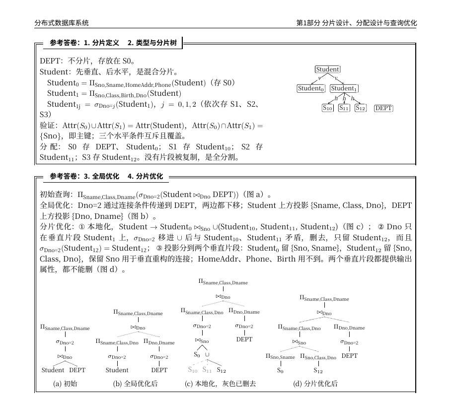

# 分布式数据库系统往年试题参考解析

分布式数据库课程往年期末试题的参考解析，题目选自 2004–2023 年的试卷。LaTeX 源码和编译好的 PDF 都在仓库里，下载 `分布式数据库_往年试题参考解析.pdf`，共 29 页，A4 黑白排版，方便打印。

欢迎提交 PR 补充或修正。


## 内容

按知识点分为七部分。每部分先讲做法，再放真题原题和参考答卷。小节标题旁标着对应的课件页码。

1. 分片设计、分配设计与查询优化（2019、2020、2023 年第一题）
2. 代价计算：I/O 代价、执行场地、半连接
3. 分布式事务：子事务、进程模型、2PC 与故障处理
4. 并发控制：冲突、局部与全局可串行化、2PL
5. 故障恢复：日志、检查点、undo 与 redo
6. 数据复制与一致性协议：主从同步、Paxos、反熵、NWR
7. 概念题

PDF 开头有一张按题型查找的索引表和记号说明。

## 编译

需要 XeLaTeX 和这几种字体：Noto Serif CJK SC、Noto Sans CJK SC、DejaVu Sans Mono、Latin Modern Roman。装好后运行：

```bash
./compile.sh
```

脚本会连续编译两遍，第二遍补上页码引用。用 Overleaf 的话，把编译器改成 XeLaTeX。
